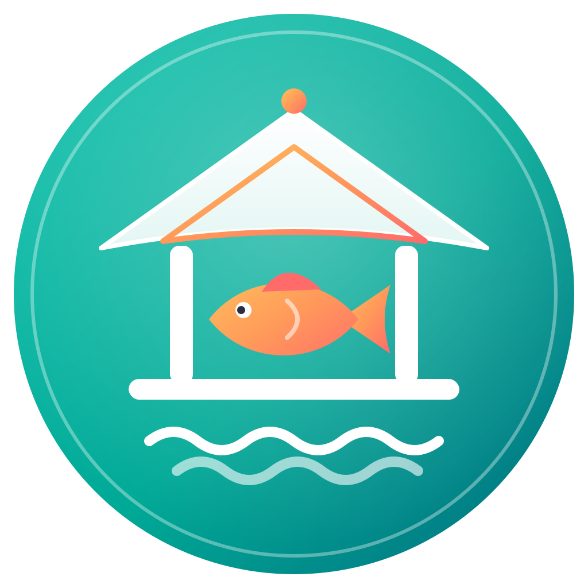

# 🐟 Bale Ikan

  

  <b>Platform Digital Jual Beli Ikan Segar Langsung dari Nelayan & Peternak</b>

  
  
  
  

---

## 📖 Deskripsi Aplikasi & Latar Belakang
**Bale Ikan** adalah aplikasi mobile berbasis *cross-platform* yang dirancang sebagai pusat pertemuan digital (*vertical marketplace*) antara produsen hasil perikanan (peternak ikan air tawar dan nelayan ikan laut) langsung dengan konsumen akhir (*end-user*). 

**Latar Belakang:** Rantai distribusi hasil perikanan tradisional yang terlalu panjang sering kali merugikan nelayan/peternak karena harga jual di tingkat bawah yang rendah, serta menurunkan tingkat kesegaran ikan sampai di tangan pembeli. Bale Ikan hadir untuk memotong rantai pasok tersebut melalui teknologi digital berbasis *mobile app*, memastikan transparansi harga, serta menjamin kualitas kesegaran ikan dari tangan pertama.

---

## 🏢 Model Bisnis E-Commerce
* **B2C (Business-to-Consumer):** Fokus utama saat ini, melayani konsumen rumah tangga, ibu rumah tangga, hingga pelaku kuliner skala kecil yang membutuhkan pasokan ikan segar harian secara langsung.
* **B2B (Business-to-Business):** Potensi pengembangan lanjutan untuk menyuplai kebutuhan restoran besar, katering, dan pasar swalayan dalam skala besar (grosir).

---

## 🎨 Filosofi Nama dan Logo
* **Arti "Bale":** Berasal dari kata *Balai* atau rumah besar panggung tradisional yang berfungsi sebagai tempat berkumpulnya orang banyak. Bale Ikan diartikan sebagai "rumah besar tempat berkumpulnya seluruh hasil panen ikan terbaik".
* **Makna Unsur Logo:**
  * **Lingkaran Gradasi Ocean Seafoam ke Deep Ocean:** Merepresentasikan luasnya ekosistem perairan tempat hidupnya hasil laut dan air tawar.
  * **Rumah Bale Putih:** Melambangkan wadah/platform yang bersih, transparan, dan terpercaya bagi para mitra dan pembeli.
  * **Ikan Golden Coral (Emas ke Coral):** Melambangkan komoditas bernilai tinggi, kemakmuran bagi nelayan/peternak, serta semangat energi yang segar.
  * **Dua Garis Gelombang & Hiasan Atap Emas Coral:** Menyatu secara harmonis menyimbolkan ombak laut/air serta kesatuan visi antara teknologi dan kesejahteraan alam.

---

## ✨ Fitur Aplikasi

### **Sudah Tersedia (Implemented):**
* 🔐 **Autentikasi Sederhana (Login Admin):** Sistem masuk aplikasi dengan validasi sesi lokal menggunakan `SharedPreferences`.
* 📱 **Navigasi Sidebar (Drawer):** Menu samping modern untuk berpindah antar halaman utama dengan cepat.
* 🏠 **Beranda & Katalog Interaktif:** Tampilan antarmuka (*UI*) modern ala e-commerce dengan bilah pencarian, banner promo, dan kartu produk responsif.
* 🗂️ **Struktur Arsitektur Modular:** Pengelompokan folder yang bersih (`helpers`, `model`, `service`, `ui`, `widget`) mengikuti standar pengembangan Flutter profesional.

### **Direncanakan (Roadmap):**
* 🛒 **Keranjang Belanja & Checkout:** Fitur pemilihan produk, jumlah kilogram, dan alamat pengiriman.
* 🚚 **Integrasi Pengiriman Khusus:** Modul pemilihan kurir rantai dingin (*cold chain/es & oksigen*).
* 💳 **Sistem Pembayaran (Payment Gateway):** Integrasi simulasi pembayaran digital dan QRIS.
* 📊 **Dashboard Manajemen Mitra & CRUD Lengkap:** Peningkatan fungsi pengelolaan data produk oleh peternak/nelayan secara *real-time*.

---

## 🛠️ Teknologi yang Digunakan
* **Framework:** [Flutter](https://flutter.dev/) (Versi 3.7.0 ke atas)
* **Bahasa Pemrograman:** [Dart](https://dart.dev/)
* **Desain Sistem:** Material Design 3
* **Manajemen State:** `setState` & *Streams*
* **Penyimpanan Lokal:** `shared_preferences`
* **Koneksi HTTP / REST API:** `dio`

---

## 🎨 Palet Warna
| Warna | Kode Hex | Penggunaan Utama |
| :--- | :--- | :--- |
| **Fresh Aqua / Ocean Seafoam** | `#00A896` | Warna Primer (App Bar, Tombol Utama, Ikon Aktif) |
| **Crisp White** | `#FFFFFF` | Latar Belakang Utama & Kartu Kontainer |
| **Soft Gray / Light BG** | `#F8F9FA` | Latar Belakang Halaman / Area Kosong |
| **Sunset Coral** | `#FF6B6B` | Warna Aksen / Tersier (Banner, Badge, Harga, Tombol Sorot) |
| **Dark Text / Charcoal** | `#2B2D42` | Teks Utama / Judul |

---

